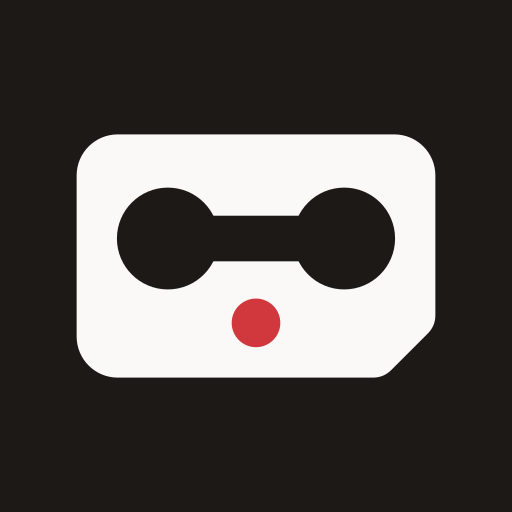
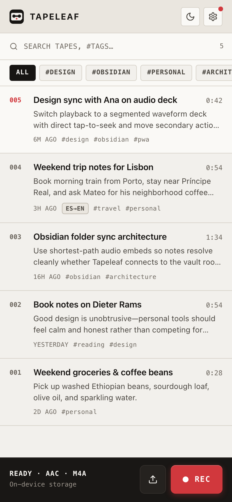
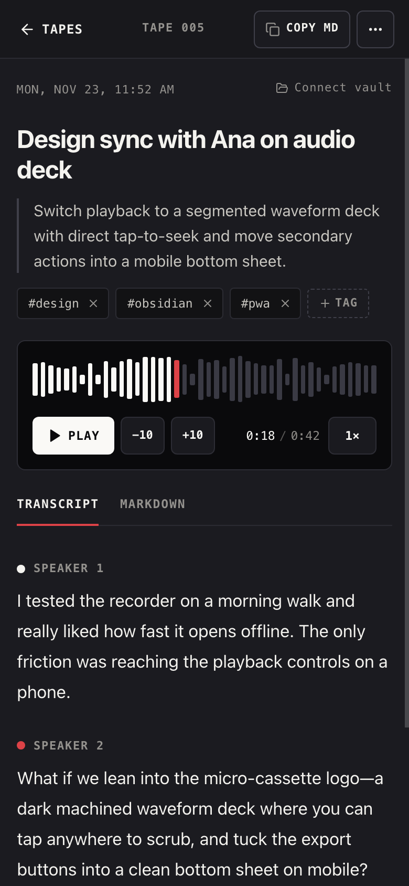
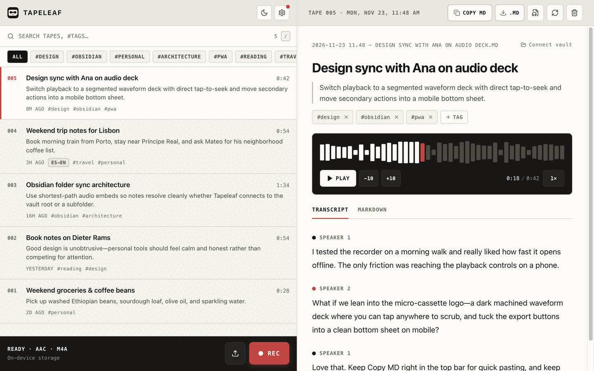
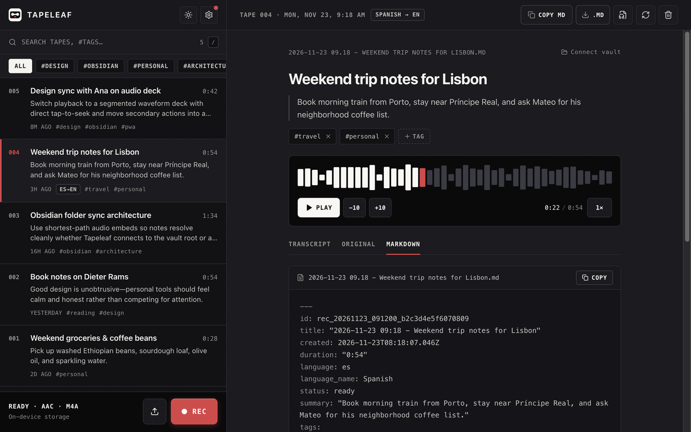

<p align="center">
  
</p>

<h1 align="center">Tapeleaf</h1>

<p align="center">
  <strong>Calm, zero-server, offline-first voice notes for Obsidian.</strong><br />
  Tap <strong>REC</strong>, speak, tap <strong>Stop</strong> — your clip is saved on-device, transcribed &amp; translated with Gemini, and written directly into your Obsidian vault as clean Markdown + embedded audio.
</p>

<p align="center">
  <a href="https://github.com/kcverde/tapeleaf/actions/workflows/ci.yml"></a>
  <a href="./LICENSE"></a>
  <a href="https://kcverde.github.io/tapeleaf/"></a>
</p>

---

## Screenshots

### Mobile (Android PWA)

<table>
  <tr>
    <td align="center" width="50%">
      <br />
      <sub><strong>Tape Library (Alabaster Light)</strong> — indexed log, tag filter strip &amp; thumb-zone REC deck</sub>
    </td>
    <td align="center" width="50%">
      <br />
      <sub><strong>Note &amp; Waveform Deck (Obsidian Dark)</strong> — tap-to-seek peaks, multi-speaker turns &amp; action sheet</sub>
    </td>
  </tr>
</table>

### Desktop

<table>
  <tr>
    <td align="center" width="50%">
      <br />
      <sub><strong>Alabaster Light</strong> — two-pane tape log, waveform playback deck &amp; speaker diarization</sub>
    </td>
    <td align="center" width="50%">
      <br />
      <sub><strong>Obsidian Dark</strong> — bilingual <code>ES → EN</code> translation &amp; live Obsidian Markdown preview</sub>
    </td>
  </tr>
</table>

---

## Why Tapeleaf?

- **100% Zero-Server &amp; Offline-First PWA:** Install to your Android Home Screen and record even in Airplane Mode. Periodic audio draft chunks persist to IndexedDB while recording for crash recovery, and offline clips queue automatically until you're back online.
- **Direct Obsidian Vault Folder Sync:** Uses the File System Access API (`showDirectoryPicker`) to write both `YYYY-MM-DD HH.MM - Concise Title.md` and `audio/<id>.<ext>` straight into a folder inside your Obsidian vault. **Obsidian Sync** picks up both automatically across all your devices.
- **Tactile Field-Recorder UX:** Full-screen distraction-free mobile **Live Capture Bay** while walking, segmented Web Audio waveform scrubber with speed controls (`1×`–`2×`), and Alabaster Light / Anodized Obsidian Dark themes.
- **Multilingual Transcription, Translation &amp; Speaker Turns:** Uses your own Google Gemini API key directly from the browser to auto-detect language, translate non-English speech to English (preserving the original transcript in a separate tab &amp; section), identify multiple speakers, generate a title + 1-line summary, and suggest `#tags`.
- **Safe Around Your Obsidian Edits:** Persists rename intent before moving files, checks content hashes before overwriting or deleting externally edited notes, neutralizes untrusted Markdown/HTML/Templater/DataviewJS syntax, and keeps local deletion separate from vault deletion by default.
- **Bring Your Own Key (No Account, No Backend):** Your Gemini API key is held in session memory by default (clears on reload/close), with an opt-in **Remember key on this device** toggle.

---

## Example Obsidian Output

Every recording produces a clean, self-contained Markdown note paired with a shortest-path audio embed (`![[rec_....m4a]]`) that plays cleanly whether you connect your vault root or a subfolder like `MyVault/Tapeleaf/`:

```markdown
---
id: rec_20261123_091200_b2c3d4e5f6070809
title: "2026-11-23 09:18 - Weekend trip notes for Lisbon"
created: 2026-11-23T08:18:07.046Z
duration: "0:54"
language: es
language_name: Spanish
status: ready
summary: "Book morning train from Porto, stay near Príncipe Real, and ask Mateo for his neighborhood coffee list."
tags:
  - travel
  - personal
audio: audio/rec_20261123_091200_b2c3d4e5f6070809.m4a
---

# Weekend trip notes for Lisbon

> Book morning train from Porto, stay near Príncipe Real, and ask Mateo for his neighborhood coffee list.

![[rec_20261123_091200_b2c3d4e5f6070809.m4a]]

## Transcript

Quick reminder for the Lisbon weekend next month. Let us take the early Alfa Pendular train from Porto so we arrive before lunch...

## Original (Spanish)

Recordatorio rápido para el fin de semana en Lisboa el mes que viene...
```

---

## Quick Start

### On Android (Recommended)

1. Open your hosted Tapeleaf URL (or the [live GitHub Pages build](https://kcverde.github.io/tapeleaf/)) in **Chrome for Android (v132+)**.
2. Tap Chrome's menu → **Add to Home Screen** to install as a standalone PWA.
3. Tap **Settings** (gear icon):
   - Paste a Gemini API key from [Google AI Studio](https://aistudio.google.com/apikey) (optionally enable **Remember key on this device**).
   - Tap **Connect vault** and choose a subfolder (e.g. `Tapeleaf`) inside your Obsidian vault in **Device storage**.
     *(Android blocks top-level `Downloads`/`Documents` and Obsidian's private app storage.)*
4. In Obsidian → **Settings → Sync**, enable **Audio** so voice attachments sync with your notes *(Sync Standard caps single files at 5 MB; Sync Plus at 200 MB)*.

> **Android folder permission note:** After the OS restarts an installed PWA, tap the **Reconnect** LED pill in the top bar once to re-authorize folder access—all queued notes stay safe in IndexedDB and flush to your vault automatically.

### On Desktop

Open Tapeleaf in **Chrome** or **Edge** to use direct vault folder sync, or in **Safari / Firefox** with one-click **Copy MD**, **Download `.md`**, and **Download Audio** (saved under the exact embedded filename so manual drops into Obsidian resolve `![[...]]` automatically).

---

## Browser Support

| Capability | Chrome Android 132+ | Desktop Chrome / Edge | Safari / iOS | Firefox |
| :--- | :---: | :---: | :---: | :---: |
| Offline PWA &amp; local recording | Yes | Yes | Yes | Yes |
| Gemini transcription &amp; translation | Yes | Yes | Yes | Yes |
| Direct Obsidian folder write (`showDirectoryPicker`) | Yes | Yes | — *(use Copy / Download)* | — *(use Copy / Download)* |
| Native audio share sheet | Yes | OS-dependent | Yes | — |

---

## Self-Hosting (Deploy Free)

Tapeleaf is a 100% static Vite build (`dist/`), so you can host it anywhere for free with automatic HTTPS:

- **Cloudflare Pages / Vercel / Netlify (Recommended — dedicated origin):** Connect this repository with build command `npm run build` and output directory `dist`.
- **GitHub Pages (subpath `/tapeleaf/`):** Included via [`.github/workflows/deploy.yml`](./.github/workflows/deploy.yml). Build locally with `VITE_BASE_PATH=/tapeleaf/ npm run build` — both `manifest.webmanifest` and `sw.js` automatically adapt to `VITE_BASE_PATH`.

> **Origin isolation tip:** Because `localStorage` and IndexedDB are scoped per browser origin, prefer hosting Tapeleaf on its **own dedicated origin** if you choose **Remember key on this device**, and apply API key restrictions in Google AI Studio. See [SECURITY.md](./SECURITY.md) for the full trust model.

---

## Local Development

Requires **Node.js 24+** (matching CI).

```bash
git clone https://github.com/kcverde/tapeleaf.git
cd tapeleaf
npm install
npm run dev
# Open http://127.0.0.1:5173
```

Run checks, tests, and builds:

```bash
npm run typecheck
npm test
npm run build
VITE_BASE_PATH=/tapeleaf/ npm run build
```

---

## Contributing &amp; Security

- Contributions are welcome! See [CONTRIBUTING.md](./CONTRIBUTING.md) for the project map and PR checklist.
- For privacy details or reporting vulnerabilities, see [SECURITY.md](./SECURITY.md).
- Released under the [MIT License](./LICENSE).
